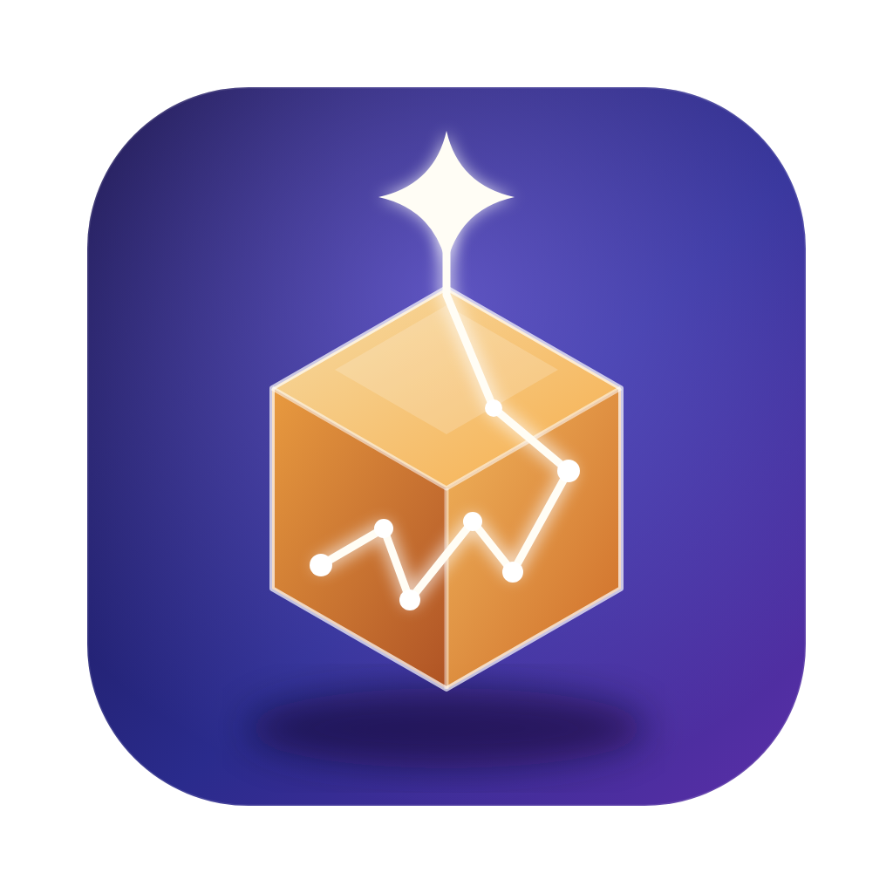

<div align="center">



# MemFlow

**本地优先的 Mac AI 第二大脑 · 重输入、轻管理**

随手记下一句话、一张截图、一份文档,本地 Ollama 在后台自动理解、打标签、向量化;需要时用对话取回,回答 100% 带可追溯来源。

[](https://github.com/ixxxxoooo/MemFlow/actions/workflows/ci.yml)
[](https://github.com/ixxxxoooo/MemFlow/releases/latest)
[](LICENSE)


[English](#english) · [下载](#下载与安装) · [快速开始](#快速开始) · [贡献](CONTRIBUTING.md)

</div>

## 特性

- **闪念胶囊**:全局快捷键(默认 `Cmd+Shift+K`)唤起 Spotlight 风格输入框;回车保存、`Cmd+V` 粘贴截图、拖入文件;失焦自动收起,托盘常驻。
- **全本地(默认)**:嵌入 `bge-m3`、文本 `qwen2.5:7b`、视觉 `minicpm-v`(默认关闭),数据与推理都不出本机。
- **可选云端文本模型**:设置里可切换到 DeepSeek 等 OpenAI 兼容接口,向量化与原始数据仍留在本机(见下文隐私说明)。
- **混合检索**:向量 + FTS5(jieba 中文分词)→ RRF 融合 → 时效加权 → 相关度门槛。
- **可溯源问答**:只依据你的记录回答,`[n]` 角标可点击,右侧抽屉查看原文;无相关资料时直接拒答,不编造。
- **Mermaid 流程图**:校验 → 自动修复 → 缩放拖拽 → 导出 SVG/PNG。
- **文档导入**:txt / md / pdf / docx,自动分块并生成全局摘要。
- **健壮**:原始数据先落盘、AI 处理异步可重试;持久化任务队列 + 崩溃恢复;Ollama 离线不丢数据;一键重刷。

## 下载与安装

前往 [Releases](https://github.com/ixxxxoooo/MemFlow/releases/latest) 下载对应架构的 `.dmg`:

| 芯片 | 文件 |
| --- | --- |
| Apple Silicon (M 系列) | `MemFlow_<版本>_aarch64.dmg` |
| Intel | `MemFlow_<版本>_x64.dmg` |

每个版本附带 `SHA256SUMS.txt`,可用 `shasum -a 256 -c SHA256SUMS.txt` 校验。

> **关于签名**:当前发布包使用 ad-hoc 签名,未经过 Apple 公证。首次打开如被 Gatekeeper 拦截,请在「访达」中右键 → 打开,或执行:
>
> ```bash
> xattr -cr /Applications/MemFlow.app
> ```

## 快速开始

1. 安装并启动 [Ollama](https://ollama.com)。
2. 打开 MemFlow,顶部横幅会提示缺失的模型,点击「一键下载」(`bge-m3` 约 1.2GB,`qwen2.5:7b` 约 4.7GB)。
   - 若系统代理(如 Quantumult X)使用 fake-ip(`198.18.x.x`)导致 `ollama pull` 报 `redirect target not allowed`,在「设置 → 模型状态与下载」点「**直连下载**」即可;也可用终端脚本 [`scripts/pull_model_manual.sh`](scripts/pull_model_manual.sh):
     ```bash
     scripts/pull_model_manual.sh qwen2.5:7b
     scripts/pull_model_manual.sh bge-m3
     # 网络受限时可指定镜像仓库
     OLLAMA_REGISTRY=https://你的镜像地址 scripts/pull_model_manual.sh qwen2.5:7b
     ```
3. 按 `Cmd+Shift+K` 记下第一条想法,然后到「AI 问答」里提问。

### 使用云端模型(可选)

在「设置 → 文本模型来源」选择「云端 API」,挑选服务商预设(如 DeepSeek),填入 API Key,点「测试连接」后保存即可。

- 只有问答、查询改写、自动打标签、流程图修复使用云端模型;**向量化与图片解析始终使用本地 Ollama**(DeepSeek 官方没有 embedding 接口)。
- **隐私**:云端模式下,你的提问与检索到的资料片段会发送给所选服务商;原始数据和向量索引仍只保存在本机。资料敏感时请使用本地模型。
- API Key 保存在 macOS 钥匙串,不写入数据库,也不会包含在备份中。

## 从源码构建

环境要求:macOS 12+、Rust stable、Node.js ≥ 20、pnpm。

```bash
pnpm install
pnpm tauri dev        # 开发运行
pnpm tauri build      # 产出 .app 与 .dmg(位于 src-tauri/target/release/bundle)

# 测试
pnpm test                         # 前端 vitest
cd src-tauri && cargo test        # Rust 单元 + mock Ollama 集成测试
# 真机冒烟(需本机 Ollama 与已下载模型)
cd src-tauri && cargo test --test e2e_real_ollama -- --ignored --nocapture
```

## 架构概览

Tauri 2 多窗口(main / capsule / toast)+ Rust 后端 + React 19 前端。后端经 `EventSink` 与 UI 解耦,可在无窗口环境下完整测试。

- 存储:SQLite(WAL)+ FTS5 + 内存余弦向量索引(按嵌入模型隔离),数据位于 `~/Library/Application Support/MemFlow/`。
- 队列:持久化任务、崩溃恢复、指数退避;Ollama 离线或模型缺失仅重排不耗次数。
- 问答:无命中拒答 → 带编号资料 → 流式生成 → 引用校验(剔除非法 `[n]`)→ 会话落库。

更多细节见 [`.specstory/history/docs/20261015_MemFlow本地AI外脑.md`](.specstory/history/docs/20261015_MemFlow本地AI外脑.md)。

## 已知限制

- 胶囊在其他应用的全屏 Space 上可能不显示(未使用 NSPanel)。
- 扫描版 PDF 无 OCR;视觉模型默认关闭。
- 发布包为 ad-hoc 签名,未公证(见上文)。

## 参与贡献

欢迎 Issue 与 PR!请先阅读 [CONTRIBUTING.md](CONTRIBUTING.md) 与 [行为准则](CODE_OF_CONDUCT.md)。安全问题请见 [SECURITY.md](SECURITY.md)。

## 许可证

[MIT](LICENSE) © 2026 ygw

---

## English

**MemFlow** is a local-first "AI second brain" for macOS. Capture a thought, a screenshot or a document in one keystroke; a local [Ollama](https://ollama.com) instance understands, tags and indexes it in the background. Ask questions later and get answers with 100% traceable citations - or an honest refusal when nothing relevant is stored.

- Global quick-capture capsule (`Cmd+Shift+K`), tray resident
- Fully local: `bge-m3` embeddings + `qwen2.5:7b` chat (+ optional `minicpm-v` vision)
- Hybrid retrieval (vectors + FTS5 with Chinese tokenization, RRF fusion)
- Verified `[n]` citations, Mermaid flowcharts with auto-repair and SVG/PNG export
- Robust by design: raw data is persisted first, AI processing is async, retryable and crash-safe

**Install**: download the `.dmg` for your chip from [Releases](https://github.com/ixxxxoooo/MemFlow/releases/latest). Builds are ad-hoc signed (not notarized); if Gatekeeper blocks the app, right-click → Open or run `xattr -cr /Applications/MemFlow.app`.

**Build**: `pnpm install && pnpm tauri build` (requires Rust stable, Node ≥ 20, pnpm, macOS 12+).

Licensed under the [MIT License](LICENSE).
